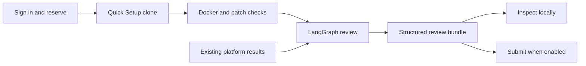

<div align="center">

# shipd-agent

**From submission to evidence-backed review.**

A Python review agent for Shipd’s Olympus and Mars workflows.<br>
Docker checks · rubric-guided reasoning · inspectable feedback · opt-in submission

[](https://github.com/vaishcodescape/shipd-agent/actions/workflows/ci.yml)
[](pyproject.toml)
[](LICENSE)

[Get started](#get-started) · [Terminal preview](#terminal-preview) · [Review approach](#how-it-models-a-human-quality-review) · [Contribute](CONTRIBUTING.md)

</div>

Reviewing a submission means moving between setup scripts, test failures, patches, agent results, and a detailed rubric. **shipd-agent brings those steps into one workflow**, then saves structured feedback you can inspect before posting.

Built for Shipd reviewers with access to the review queue, and developers who want to study or extend a Playwright + LangGraph review pipeline. Independent community project; not an official Shipd or Datacurve product.

## Why use it?

| Capability | What it gives you |
| --- | --- |
| **Check before reasoning** | Docker builds, patch checks, and the base/new/solution test contract before the LLM review |
| **Review against a rubric** | Problem, Tests, and Solution ratings with findings, evidence, and suggested fixes |
| **Choose your provider** | Anthropic, OpenAI, Google, DeepSeek, Moonshot, xAI, or an OpenAI-compatible endpoint |
| **Inspect before posting** | A JSON review bundle; feedback submission is off by default |
| **Keep track of batches** | Saved progress, cooldowns, and session statistics |
| **Adapt the workflow** | Separate modules for browser sessions, deterministic checks, reasoning, and submission |

## Terminal preview


*Offline preview rendered by the actual CLI UI functions with example statuses. It does not represent a live review or a benchmark.*

<details>
<summary><strong>See the command-line help</strong></summary>


*Captured from `./run.sh --help`. Regenerate both images with the [preview script](scripts/render_terminal_previews.py).*

</details>

## Get started

You’ll need **Python 3.10+**, Bash, Git, ripgrep (`rg`), a running Docker daemon, a Shipd reviewer account, an IMAP app password for its verification mailbox, and an API key for a supported LLM provider. The shell launcher targets macOS/Linux; Windows users need a Bash environment such as WSL. CI is configured for Python 3.10 and 3.14 on Linux.

**1. Install from source**

```bash
git clone https://github.com/vaishcodescape/shipd-agent.git
cd shipd-agent
./run.sh --setup
cp .env.example .env
```

Edit `.env`: set `AUTH_EMAIL` and `AUTH_PASSWORD`. The password is your mailbox’s **IMAP app password**, used to retrieve the Shipd sign-in code. Keep quoted passwords quoted.

**2. Choose a provider and check your environment**

```bash
./run.sh --configure-llm
./run.sh --check
```

The setup wizard asks for exploration and finalization models, then stores your API key in the OS keychain (with a restricted local file fallback). See [configuration and troubleshooting](docs/configuration.md).

**3. Run one review and keep the evidence**

```bash
./run.sh --once --no-submit --no-cleanup --headed
```

This is a **live workflow**: it signs in, clocks in, reserves or continues a submission, executes Quick Setup, runs Docker checks, and calls your LLM provider. `--no-submit` prevents posting review feedback; it is not an offline mode. `--no-cleanup` keeps the clone and Docker artifacts for inspection.

Quick Setup executes the submission’s shell script on your machine. Use a dedicated development environment for submissions you do not trust; Docker test execution does not isolate the setup script itself.

**4. Inspect the result**

Open `reviews/pending-submit.json` for the latest completed review bundle. Look at the decision, phase results, band ratings, evidence, and contributor feedback. This file is overwritten by the next saved review; copy it if you want to keep a history.

```bash
./run.sh --status
```

When ready to enable posting for a live review:

```bash
./run.sh --once --submit
```

This starts a workflow run; it does not simply upload the JSON you inspected.

## Assessment checks

The code includes the criteria reported in community assessment feedback:

| Check | Implemented behavior |
| --- | --- |
| **Prompt length** | Flags explicit task-prompt files over **1,000 words** |
| **Too Many Requirements** | Reads the platform flag and estimates independent requirements locally |
| **Agent runs** | Checks **Nova × 4, Vega × 4, Orion × 4** — 12 runs total |
| **Passing runs** | Requires **exactly one passing run overall**, belonging to one agent type |

The requirement-count threshold defaults to 10 and is a **local heuristic**, not a published Shipd threshold. Existing run results are read without clicking evaluation controls. The agent does not launch Nova, Vega, or Orion runs.

Missing data and an aggregate-only run summary have limitations: see the [criteria guide](docs/assessment-checks.md) before treating a PASS as complete verification. Assessment rules can change; this repository’s checks are not a guarantee of acceptance.

## How it models a human quality review

A good reviewer does more than check whether tests are green. They ask whether the problem is clear, the tests are fair, the solution fits the repository, and the evidence supports the verdict. The supplied [review rubric](shipd-rubric.md) makes that process explicit enough for an AI agent to follow.

**The rubric is the review specification.** It defines what to inspect, how to rate it, what counts as evidence, and when to approve, request changes, or reject. shipd-agent combines that specification with repository tools and deterministic checks:

| Human review habit | How the agent follows it |
| --- | --- |
| **Reproduce before judging** | **Phase 0:** checks the base commit, patch application, Docker setup, and test behavior before and after the solution |
| **Understand the actual request** | **Phase 1:** assesses clarity, scope, repository fit, discoverability, and whether the prompt leaks the solution |
| **Inspect the test harness** | **Phase 2:** reviews Dockerfile and `test.sh`, including whether the intended base and new tests actually run |
| **Challenge the tests** | **Phase 3:** looks for missing edge cases, brittle assertions, hidden requirements, and tests that reject valid alternative solutions |
| **Review like a maintainer** | **Phase 4:** judges correctness against the problem, repository conventions, security, maintainability, and unnecessary changes |
| **Investigate agent outcomes** | **Phase 5:** uses available run results and failure evidence to assess solvability and fairness; a pass rate alone is insufficient |
| **Make the overall judgment** | **Phase 6:** considers platform checks, related submissions, eligibility, and Mars/Olympus fit using available evidence |

The exploration model can read files, search the repository, inspect patches, and read platform panels. A bounded coverage recheck asks for missing phase evidence. The finalization model turns that evidence into **Problem / Tests / Solution scores (0–3)**, confidence levels, severity-tagged findings, and concrete feedback. Deterministic decision guards then constrain the result so known failures cannot be waved away by a positive LLM summary.

**Example of the intended reasoning:** a new test expects sorted output, but neither the prompt nor existing repository behavior requires sorting. A reviewer should identify a possible hidden requirement, cite the assertion and relevant prompt text, and explain the fix. Under the rubric, a confirmed, fixable fairness defect calls for `request_changes`; the contributor should get a chance to repair it. This is an illustrative example, not a captured review result.

Every finding is expected to point to a file/line, test output, or log evidence. The rubric treats uncertainty as a reason to gather more evidence or request changes, and reserves rejection for extreme cases such as confirmed duplication or no credible fix path.

This reproduces a **review process**, with explicit criteria and inspectable reasoning. It does not establish that the agent matches expert human accuracy: models can miss defects, misread intent, or overstate confidence, and platform evidence can be incomplete. Inspect the saved review and its cited evidence before relying on the verdict. A reproducible evaluation against expert-reviewed examples is a [proposed next step](docs/roadmap.md).

## How it works



The review pipeline covers phases 0–6 of the [bundled rubric](shipd-rubric.md). Deterministic checks feed into the LLM review, which gathers repository evidence and produces a structured verdict. Approval guards account for failed phases, blocking findings, and low band scores.

| Output | Where to find it |
| --- | --- |
| Latest completed review and submission context | `reviews/pending-submit.json` |
| Run log | `logs/run.log` by default |
| Batch resume state | `logs/watch-batch.json` |
| Form failure screenshots and diagnostics | `logs/debug-submit/` |
| Cloned submissions | `submissions/` (keep with `--no-cleanup`) |

## Everyday commands

```bash
./run.sh --help                          # All options
./run.sh --once --quest mars --no-submit # Review a Mars submission
./run.sh --once --no-submit --provider openai
./run.sh --reviews 5 --submit            # Five live reviews with posting enabled
./run.sh --status                        # Session summary and batch progress
./run.sh --configure-llm                 # Change provider, models, or key
```

**Already have a submission cloned?** Run the review entry point directly, without signing in or reserving through the browser:

```bash
.venv/bin/python shipd-agent/review_agent.py /path/to/submission \
  --quest olympus --output reviews/local-review.json
```

This still runs checks and calls the configured LLM. Browser-only platform evidence is unavailable. Its `--dry-run` option skips LLM calls but still runs Phase 0; an incomplete dry run returns a nonzero exit code.

## Make it your own

Start with the part you want to improve:

| You want to… | Start here |
| --- | --- |
| Update assessment rules | [`rubric_defaults.py`](shipd-agent/review/rubric_defaults.py) and the [rubric](shipd-rubric.md) |
| Improve prompt/run checks | [`prompt_checks.py`](shipd-agent/review/prompt_checks.py), [`agent_runs_checks.py`](shipd-agent/review/agent_runs_checks.py) |
| Add a provider | [`llm_providers.py`](shipd-agent/review/llm_providers.py) |
| Change agent behavior | [`graph.py`](shipd-agent/review/graph.py), [`tools.py`](shipd-agent/review/tools.py) |
| Fix browser interactions | [`workflow/`](shipd-agent/workflow), [`scrape.py`](shipd-agent/review/scrape.py) |

Read the [contribution guide](CONTRIBUTING.md) for setup and tests, or browse [proposed improvements](docs/roadmap.md). Small fixes, anonymized UI fixtures, and clearer setup instructions are welcome.

**If shipd-agent helps your review workflow, give it a star.** Fork it to try a provider, improve a check, or build a better reviewer — and send useful changes back as a pull request.

[Report a bug](https://github.com/vaishcodescape/shipd-agent/issues/new?template=bug_report.yml) · [Suggest an improvement](https://github.com/vaishcodescape/shipd-agent/issues/new?template=feature_request.yml) · [MIT license](LICENSE)
