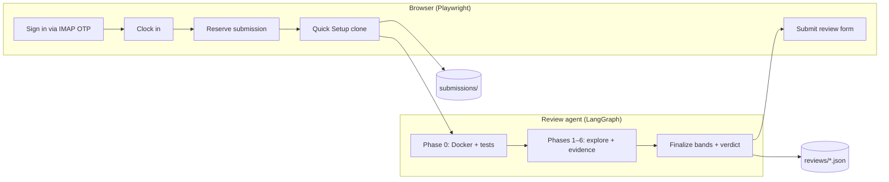

# >- shipd-agent

End-to-end autonomous reviewer for [Shipd.ai](https://shipd.ai) (Datacurve's Olympus/Mars quest workflow).

The agent signs in, clocks in, reserves a submission, clones it via Quick Setup, runs mechanical Phase 0 checks (Docker + `test.sh`), performs a rubric-aligned LLM review, and optionally submits structured feedback on Shipd — all without human intervention.

## Why this exists

Shipd's quality loop depends on **automated tests plus human review**. Reviewer throughput is the bottleneck. This agent mirrors a trained Shipd reviewer: same rubric (`shipd-rubric.md`), same band ratings, same contributor-facing feedback format — but runs continuously in batch mode with resume, cooldowns, and session accounting.

## Architecture



**Pipeline phases**

| Step | What happens |
|------|----------------|
| Auth | Headless Clerk login; OTP fetched over IMAP |
| Clock in | Starts Shipd time log for the quest |
| Reserve | Claims the next available submission |
| Clone | Runs Quick Setup script into `./submissions/` |
| Phase 0 | Builds Docker image, runs `test.sh` (base/new/solution) |
| Review | LangGraph agent explores repo, scores Problem/Tests/Solution bands 0–3 |
| Submit | Fills Shipd review form via Playwright (opt-in) |
| Cleanup | Removes clone + Docker artifacts (configurable) |
| Clock out | Posts per-quest session summary on batch completion |

## Install

**From source (recommended)**

```bash
git clone https://github.com/vaishcodescape/shipd-agent.git
cd shipd-agent
./run.sh --setup
cp .env.example .env     # AUTH_EMAIL, AUTH_PASSWORD
./run.sh --configure-llm # pick an LLM provider + models, store the API key securely
./run.sh --check         # validate environment before first run
```

**From GitHub Releases** (install the published wheel)

```bash
pip install https://github.com/vaishcodescape/shipd-agent/releases/download/v0.1.0/shipd_agent-0.1.0-py3-none-any.whl
```

**From GitHub Packages** (if enabled for your org)

```bash
pip install shipd-agent \
  --index-url https://pypi.pkg.github.com/vaishcodescape/simple/
```

## Quick start

**Safe first run** — review locally, do not submit on Shipd:

```bash
./run.sh --once --no-submit
```

**Full cycle** — review and submit one submission:

```bash
./run.sh --once --submit
```

**Overnight batch** — 10 reviews, cooldown every 5 completed:

```bash
./run.sh --reviews 10 --submit
```

**Monitor progress**

```bash
./run.sh --status
```

Submit is **off by default**. Pass `--submit` explicitly when you want feedback posted to Shipd.

## Choosing an LLM

The review agent works with any of these providers. Anthropic stays the default, so an existing `.env` with `ANTHROPIC_API_KEY` keeps working unchanged. If you installed before multi-provider support, rerun `./run.sh --setup` once to add `langchain-openai`, `langchain-google-genai` and `keyring`.

| Provider | `REVIEW_PROVIDER` | API key env var | Default explore / finalize model |
|----------|-------------------|-----------------|----------------------------------|
| Anthropic (Claude) | `anthropic` (default) | `ANTHROPIC_API_KEY` | `claude-sonnet-4-6` / `claude-opus-4-8` |
| OpenAI (GPT) | `openai` | `OPENAI_API_KEY` | `gpt-6.1-sol` / `gpt-6.1-sol` |
| Google (Gemini) | `google` | `GEMINI_API_KEY` (or `GOOGLE_API_KEY`) | `gemini-3.8-flash` / `gemini-4-argon` |
| DeepSeek | `deepseek` | `DEEPSEEK_API_KEY` | `deepseek-flash` / `deepseek-v4-pro` |
| Moonshot (Kimi) | `moonshot` | `MOONSHOT_API_KEY` | `kimi-k3.1-pro` / `kimi-k3.1-pro` |
| xAI (Grok) | `xai` | `XAI_API_KEY` | `grok-4.7` / `grok-4.7` |
| Any OpenAI-compatible endpoint | `openai-compatible` | `REVIEW_LLM_API_KEY` | set `REVIEW_EXPLORE_MODEL` and `REVIEW_LLM_BASE_URL` |

The **explore** model drives the tool-calling pass over the repo. The **finalize** model (`REVIEW_MODEL`) writes the structured verdict. You can use any model ID the provider offers. The table only lists the defaults.

**Interactive setup (recommended)**

```bash
./run.sh --configure-llm
```

This asks for the provider, an explore model and a finalize model (pick from a list or type any ID), then the API key. Key input is hidden.

- The key is saved to the OS keychain: macOS Keychain on a Mac, Windows Credential Locker, or Secret Service on Linux.
- With no keychain available, it goes to `~/.config/shipd-agent/credentials`, with the file at `0600` and the directory at `0700`.
- The key is never written to `.env`, never printed or logged (`--check` shows only the last 4 characters), and never passed as a command-line argument.
- The provider and model choices are saved to `.env` as `REVIEW_PROVIDER`, `REVIEW_EXPLORE_MODEL` and `REVIEW_MODEL`, so later runs reuse them.

When a review run finds no key for the selected provider, it asks for one (hidden input) and stores it, as long as it runs in a terminal. In cron, CI or with piped stdin, it stops right away with an error that says what to set.

**Key lookup order:** the provider's env var (shell or `.env`) first, then the stored key.

**Per-run overrides**

```bash
./run.sh --once --no-submit --provider openai                    # provider defaults
./run.sh --once --no-submit --provider gemini --model gemini-3.8-flash
./run.sh --once --no-submit --explore-model claude-haiku-5-5     # keep provider, change explore model
./run.sh --check --provider deepseek                             # is that provider ready?
./run.sh --forget-llm-key                                        # remove the stored key (current provider)
./run.sh --forget-llm-key --provider xai                         # ...or a specific one
```

If you switch provider with `--provider` and leave out `--model` and `--explore-model`, that provider's default models are used, not the models saved in `.env`.

**Provider notes**

- **OpenAI:** calls go through the Responses API, because current GPT models only support tool calling there.
- **Gemini:** uses the native Gemini API (`langchain-google-genai`), which keeps Gemini 3+ thought signatures intact across tool calls.
- **DeepSeek:** runs in non-thinking mode, because thinking mode rejects the forced tool choice that structured output needs.
- **Kimi K3:** gets `tool_choice="required"` and has its `reasoning_content` passed back on each turn.
- **Reasoning effort:** OpenAI, Gemini and Kimi run at `REVIEW_REASONING_EFFORT=low` by default. Thinking tokens count toward `REVIEW_*_MAX_OUTPUT_TOKENS`.
- **Escape hatches:** `REVIEW_STRUCTURED_OUTPUT_METHOD` (`function_calling`, `json_schema` or `json_mode`) and `REVIEW_LLM_BASE_URL` (proxies and regional endpoints).

**Adding a provider:** if it has an OpenAI-compatible API, append one `ProviderSpec` entry with its base URL, key env var and default models to `shipd-agent/review/llm_providers.py`.

## Test Demo  

For a live walkthrough without posting to Shipd:

```bash
./run.sh --check
./run.sh --once --no-submit --headed    # visible browser; review only
./run.sh --status
```

Inspect the generated review bundle under `reviews/` before enabling `--submit`.

## Quality controls

- **Rubric-aligned**: 7 phases (0–6), band ratings, severity-tagged findings, contributor feedback without internal jargon
- **Evidence-bound**: every claim must cite `file:line`, test output, or Phase 0 logs — no fabrication
- **Deterministic gates**: LOC thresholds, patch-apply checks, Docker test contract before LLM explore
- **Coverage recheck**: re-prompts the agent when required rubric phases lack evidence
- **Human-readable output**: review bundles saved to `reviews/` for audit before submit

## Requirements

- Python 3.14+
- Playwright Chromium (`./run.sh --setup`)
- Docker  
- IMAP app password for headless Shipd login
- An API key for one supported LLM provider: Claude, GPT, Gemini, DeepSeek, Kimi, Grok, or any OpenAI-compatible endpoint (see [Choosing an LLM](#choosing-an-llm))

See `.env.example` for provider and model selection, token budgets, cooldowns, and cleanup options.

## CLI reference

```bash
./run.sh --help            # full option list
./run.sh --version         # installed version
./run.sh --check           # environment doctor (LLM provider, models, masked key)
./run.sh --status          # session stats + batch resume state
./run.sh --configure-llm   # choose provider/models, store API key in the OS keychain
./run.sh --forget-llm-key  # delete the stored API key
```

Built by vaishcodescape ☕
